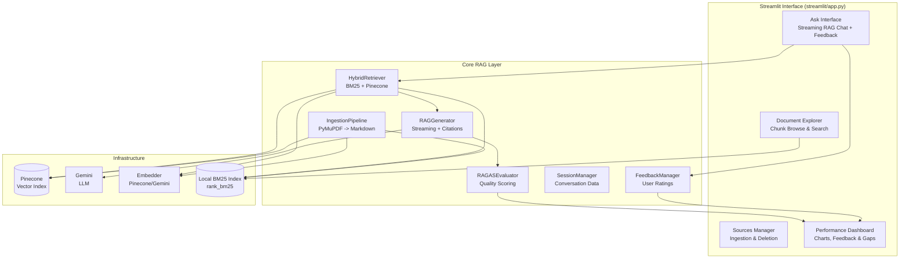
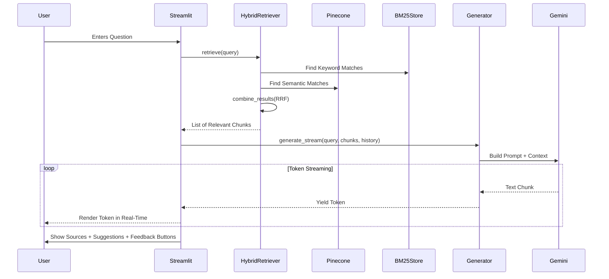

# Askly System Architecture

## Overview

Askly is an AI-powered enterprise intelligence platform designed to transform static documentation into an interactive knowledge base. It indexes PDF and Markdown files using a high-fidelity **Hybrid Search** strategy (BM25 lexical + Pinecone semantic), uses **LlamaIndex QueryFusionRetriever** to merge results with **Reciprocal Rank Fusion (RRF)**, and generates context-grounded answers using **Gemini**.

Embeddings are generated using either **Pinecone** (default, free tier) or **Gemini** (configurable), both at 1024 dimensions for seamless switching.

The system is built as a unified Streamlit application, integrating a high-performance RAG (Retrieval-Augmented Generation) pipeline with a custom "Geist" themed dashboard.

---

## System Diagram



---

## Data Flow



---

## Retrieval & Scoring Pipeline

Askly uses a multi-stage pipeline to ensure the most relevant documentation is always retrieved:

```
User Query
    |
    +---> BM25 (Sparse)
    |         Iterates over local tokenized document corpus.
    |         High precision for acronyms & specific terms.
    |
    +---> Pinecone (Dense)
              Pinecone or Gemini Embeddings (configurable).
              High recall for conceptual/semantic matches.
    |
    v
Reciprocal Rank Fusion (RRF)
    Combined Score = Sum( 1 / (60 + rank_i) )
    Merges Sparse and Dense lists into a single prioritized ranking.
    |
    v
Top-K Selection
    The top 5-10 chunks are selected for the LLM context window.
    |
    v
Context Grounding
    Gemini synthesizes the final answer using ONLY the 
    provided chunks, citing specific document names and pages.
```

---

## Component Descriptions

| Component | File | Responsibility |
|---|---|---|
| Main App | `streamlit/app.py` | State management, UI rendering, and service routing. |
| IngestionPipeline | `askly/core/ingestion/pipeline.py` | Handles PDF parsing, chunking, and dual-indexing. |
| PineconeEmbedder | `askly/core/ingestion/pinecone_embedder.py` | Generates embeddings using Pinecone's inference API (default). |
| GeminiEmbedder | `askly/core/ingestion/gemini_embedder.py` | Generates embeddings using Gemini's API (configurable). |
| HybridRetriever | `askly/core/retrieval/hybrid.py` | Uses LlamaIndex to orchestrate RRF fusion across Pinecone and BM25 retrievers. |
| RAGGenerator | `askly/core/generation/generator.py` | Uses a LlamaIndex RetrieverQueryEngine for prompt synthesis, streaming output, and source extraction. |
| RAGASEvaluator | `askly/core/evaluation/ragas_eval.py` | Scores responses using full RAGAS library, falling back to Gemini judge, then heuristic. Returns typed `AnalyticsSummary`. |
| FeedbackManager | `askly/core/feedback/manager.py` | Persists user 👍/👎 ratings and comments. |
| SessionManager | `askly/core/conversation/session.py` | Persists conversation turns to disk as JSON. Recent sessions loaded on startup and surfaced in sidebar for switching. |
| PineconeStore | `askly/core/retrieval/pinecone_store.py` | Cloud vector database interface with auto-cleanup on index recreate. |
| BM25Store | `askly/core/retrieval/bm25_store.py` | Persistent local lexical index + chunk explorer. |
| Config | `askly/config.py` | Pydantic validation for environment secrets, including embedder selection. |

---

## Startup Behaviour

On application launch, `get_services()`:
1. Validates `.env` variables (API keys, index names, embedder selection).
2. Initializes the **Gemini Client** and **Pinecone Index**.
3. Initializes the selected embedder (Pinecone or Gemini) based on `PINECONE_EMBEDDING_ENABLED`.
4. If Pinecone index is recreated, auto-cleans local data files (registry, BM25).
5. Queries Pinecone to fetch all document metadata and rebuilds local state (registry and BM25 index) for Streamlit Cloud persistence.
6. Checks for existing documents in `data/docs` folder against Pinecone to avoid re-ingestion.
7. Loads the **BM25 index** into memory from `.data/`.
8. Loads **Feedback** records from `data/feedback.json`.
9. Checks for existing session JSONs to restore conversation context.

---

## Quality Suite (RAGAS)

Askly implements a three-tier evaluation strategy for continuous quality tracking:

1. **Full RAGAS** (primary) — uses the `ragas` library with `faithfulness` and `answer_relevancy` metrics scored against retrieved context.
2. **Gemini Judge via Langchain** (fallback) — if the ragas library fails, uses Langchain wrappers (`LangchainLLMWrapper`, `LangchainEmbeddingsWrapper`) with `langchain-google-genai` to score the answer via Gemini.
3. **Heuristic** (final fallback) — lightweight word-overlap scoring used if both above fail.

**Configuration:**
- `RAGAS_ENABLED=true` — enables/disables evaluation entirely
- `RAGAS_GEMINI_ENABLED=false` — when false, skips both Full RAGAS and Gemini judge, using only heuristic evaluation (no Gemini API calls)

Metrics scored:
- **Faithfulness:** Answer is strictly derived from context (anti-hallucination).
- **Answer Relevancy:** Response directly addresses the user's intent.
- **Context Precision:** Signal-to-noise ratio of the retrieval engine.

*All metrics are logged to `data/ragas_scores.json` and visualized in the Performance dashboard.*

---

## User Feedback Loop

Every AI-generated answer includes inline 👍/👎 feedback buttons. Feedback is:

1. **Persisted** to `data/feedback.json` via `FeedbackManager`.
2. **Aggregated** into a satisfaction rate (positive / total).
3. **Visualized** in the Analytics dashboard as a distribution bar.
4. **Surfaced** — negative feedback with comments is shown for review.

This creates a continuous improvement loop: low-satisfaction answers highlight documentation gaps.

---

## Streaming Architecture

Askly streams answers via LlamaIndex `RetrieverQueryEngine` backed by a custom `GoogleGenAILlamaLLM` adapter:

1. **Retrieval** completes first via `HybridRetriever` — sources shown immediately.
2. **Conversational Check** — if no relevant chunks are found (score < 0.3), the system switches to conversational mode using the LLM directly for natural responses (e.g., greetings).
3. **QueryEngine** builds prompt with context and chat history, streams tokens via `response_gen`.
4. **Streamlit** renders each token using `st.write_stream()`.
5. **Post-stream** — full answer captured, RAGAS evaluation runs, session persisted to disk.
6. **LLM Failure Fallback** — if the LLM fails (quota, network, or API errors), the system displays retrieved document chunks with error details instead of a complete failure.

This reduces perceived latency from ~3-5s to ~200ms for first token.

---